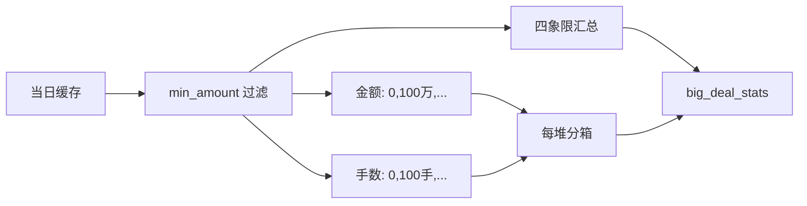

# 同花顺资金动向后端统计方案

## 目标与边界

- **数据源**：仅同花顺 HQ 大单（`aggressor × side` 四象限），复用现有会话缓存。
- **交付**：后端统计模块 + HTTP 接口；**本阶段不改前端**。
- **口径**：对「门槛过滤后」的全量列表做汇总（与列表同一 `min_amount` / `day`），不依赖分页切片。
- **细分**：四象限内支持两种固定步进分箱（均从 **0** 递加，盖住当日样本最大值）：
  - **金额**：步长 **100 万**（`1_000_000` 元）
  - **手数**：步长 **100 手**（`100`，对明细 `volume_lots`）
- 不写死业务档位、不用分位数；边界由样本 max 决定档数。

## 现状可复用

- 缓存：`statistics/fundflow/tonghuashun/store.py` → `get_session_orders`
- 列表：`statistics/fundflow/tonghuashun/big_deal.py` → `fetch_big_deals`
- 路由：`statistics/fundflow/api.py` → `/api/stocks/fund-flow`
- 明细字段：`side` / `aggressor` / `amount` / `volume_lots`（见 `hq._parse_row`）



## 统计口径

过滤：`amount >= min_amount`。

| 维度 | 指标 |
|------|------|
| 四象限 | `count`、`amount`、`volume_lots`，外加按需的 `amount_bins` / `lots_bins` |
| 买卖合计 | `buy` / `sell` 仅总量（bins 只挂四象限） |
| 净值 | `net_amount`、`active_net_amount` |
| 元信息 | `code`、`session_day`、`min_amount`、`total_count`、`cached`、`cached_at`、`source`、`bin_by`、`amount_step`、`lots_step` |

不输出股数、不输出 `active`/`passive` 合计。分类与前端 `bigDealEventType` 对齐。

### 分箱规则（金额 / 手数对称）

| 类型 | 字段 | 步长常量 | 边界单位 |
|------|------|----------|----------|
| 金额 | `amount` | `AMOUNT_STEP = 1_000_000` | 元：`0, 1e6, 2e6, …` |
| 手数 | `volume_lots` | `LOTS_STEP = 100` | 手：`0, 100, 200, …` |

共用算法 `build_step_edges(max_value, step)`：

1. 无样本 → 对应 bins 为空列表
2. `N = ceil(max_value / step)`（`max_value<=0` 则空）
3. 区间 `[i*step, (i+1)*step)`，`i = 0 .. N-1`，最后一档右端为 `N*step`
4. **四堆共用同一套该类型 edges**
5. 响应从 `lo=0` 完整输出到覆盖 max（空档 `count=0`）

每档：`lo`、`hi`、`count`、`amount`、`volume_lots`。

### 选用哪套分箱：`bin_by`

| 值 | 行为 |
|----|------|
| `amount`（默认） | 只出 `amount_bins` |
| `lots` / `volume_lots` | 只出 `lots_bins` |
| `both` | 两套都出 |

示例（`bin_by=both` 时单堆结构）：

```json
"active_buy": {
  "count": 40,
  "amount": 8.0e7,
  "volume_lots": 20000,
  "amount_bins": [
    {"lo": 0, "hi": 1000000, "count": 0, "amount": 0, "volume_lots": 0},
    {"lo": 10000000, "hi": 11000000, "count": 3, "amount": 0, "volume_lots": 0}
  ],
  "lots_bins": [
    {"lo": 0, "hi": 100, "count": 0, "amount": 0, "volume_lots": 0},
    {"lo": 500, "hi": 600, "count": 2, "amount": 0, "volume_lots": 0}
  ]
}
```

**不做**：自定义 `edges`/`bin_count`、分钟序列、东财对照。

## 接口形态

- `GET /api/stocks/fund-flow?code=002384&scope=big_deal_stats&source=tonghuashun&min_amount=10000000&bin_by=amount`
- `bin_by=lots` 或 `bin_by=both` 切换手数分箱或两套一起
- `refresh` / `day` / `min_amount` 与 `big_deal` 一致

## 代码改动点

1. 新增 `statistics/fundflow/tonghuashun/stats.py`：`classify_event`、`build_step_edges`、`aggregate_big_deals`、`fetch_big_deal_stats`
2. `fetcher` / `api` / `__init__` 接入 `big_deal_stats` + `bin_by`
3. `tonghuashun/__main__.py`：`--stats`、`--bin-by`
4. 不改前端、东财、缓存格式

## 验证

- `sum(四象限.count)==total_count`；每堆 `sum(amount_bins.count)` / `sum(lots_bins.count)` 等于该堆 `count`（在对应 bin 启用时）
- 金额档步长 100 万、手数档步长 100，首档 `lo==0`
- `bin_by` 三种取值字段出现符合约定；无样本 bins 为空；历史日无缓存不打 HQ
